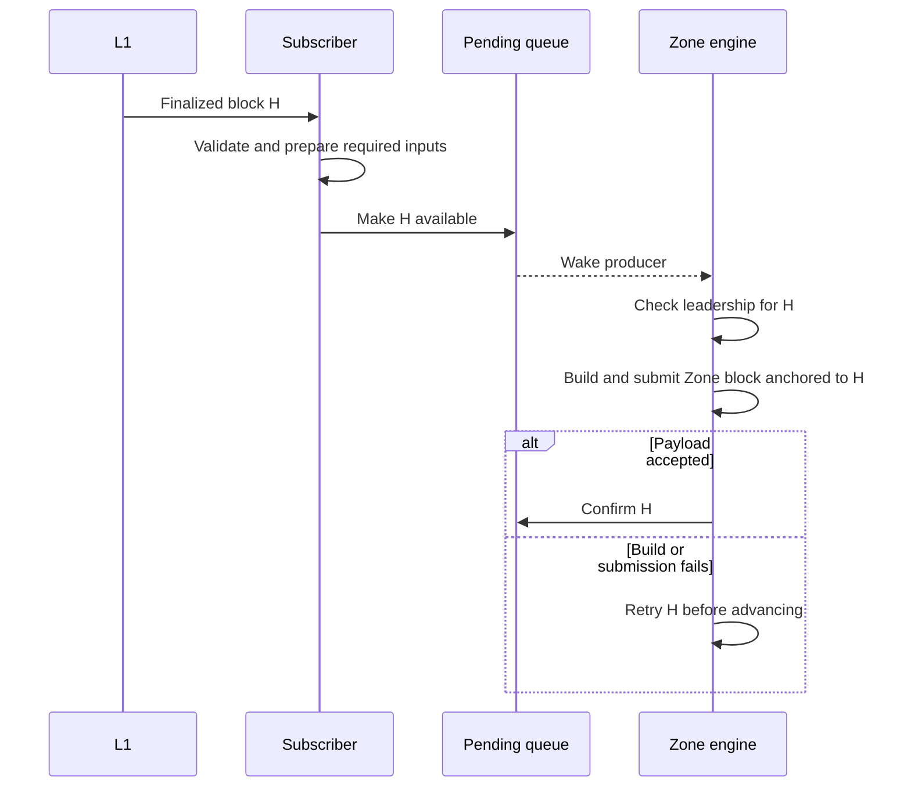

# Speaking in Tokens

Running notes on communicating engineering intent to machines.

## What we care about

Can we improve the fraction of autonomous engineering runs that succeed without human steering by giving agents a better representation of design goals, constraints, boundaries, and data flow?

We want something easy for humans to write, inspect, and agree on, but precise enough for a machine to implement and check. Mermaid diagrams are one possible bridge. The objective is not to replace English for its own sake: it is to reduce unstated assumptions and make important requirements enforceable.

Working distinction:

- Prose explains goals, motivation, and tradeoffs.
- Diagrams expose actors, ownership, ordering, and data flow.
- Contracts and invariants specify what must or must not happen.
- Executable checks test whether an implementation respects those requirements.

A change of notation alone may not help. We need to distinguish better formatting from better specification, and better specification from better verification.

## Papers we care about

### 1. Intent Formalization: A Grand Challenge for Reliable Coding in the Age of AI Agents

**Shuvendu K. Lahiri — March 2026 — position paper / arXiv**

- [Paper](https://arxiv.org/abs/2603.17150)
- [Full text](https://arxiv.org/html/2603.17150v1)
- [Microsoft Research publication record](https://www.microsoft.com/en-us/research/publication/intent-formalization-a-grand-challenge-for-reliable-coding-in-the-age-of-ai-agents/)

**Why we care:** An agent can faithfully implement its interpretation of a request and still build the wrong thing. The paper calls the gap between informal intent and precise program behavior the intent gap. It proposes translating intent into checkable specifications, ranging from concrete examples and assertions to formal contracts and domain-specific languages.

The particularly interesting flow:

```text
Human describes the goal
→ agent exposes its interpretation as a specification
→ human resolves ambiguities and agrees on the boundaries
→ agent implements against the specification
→ tools check compliance and return actionable failures
```

**The hard part:** A specification can be wrong or incomplete. Proving code satisfies it does not prove that it captures the human's intent. The human review surface is therefore a central design problem: how can we make assumptions and omissions easy to spot before implementation?

**What this paper supports:** This is an established research problem with concrete approaches and prior work behind it.

**What it does not establish:** That Mermaid beats equivalent prose, that formal specifications are easy for humans to author, or that this workflow guarantees autonomous production-quality engineering.

**Validation status:** Paper and Microsoft Research attribution verified. This is a position paper synthesizing earlier work, not a controlled experiment establishing the best representation. We have not independently reproduced its cited experiments.

## Worked example: L1 subscriber drives Zone block production

Starting request:

> The L1 subscriber should drive block production.

This is an illustrative specification exercise, not an approved implementation change.

### Relevant current behavior

Inspected in the Zones checkout on 2026-09-14:

- `crates/l1/src/subscriber.rs`: subscriber queues finalized L1 blocks.
- `crates/node/src/engine.rs`: queue notifications wake production; a one-second forkchoice heartbeat also drains available work.
- `crates/l1/src/queue.rs`: pending blocks are ordered and exact tip redelivery is deduplicated.
- The engine confirms a pending block after a valid `newPayload` response, then attempts to canonicalize the new head with a forkchoice update.

The broad event-driven behavior already exists. A useful agent should identify that before treating the request as a new architecture.

### Candidate interpretation to review

The subscriber determines when finalized L1 work becomes available. The engine owns Zone block production. Produce one Zone block per finalized L1 block, in order, including blocks without deposits. Transaction arrival alone does not trigger production.

This is a candidate interpretation, not a settled requirement.



This diagram expresses a proposed contract, not every detail of the existing implementation.

### Candidate checkable specifications

| Property | Observable check |
| --- | --- |
| No production without pending L1 work | Advance time and submit pool transactions with an empty L1 queue; no new Zone block. |
| Empty L1 blocks drive production | Deliver a finalized block with no deposits; a Zone block is produced. |
| Preserve order | Deliver H, H+1, H+2 during a slow build; committed anchors appear in order. |
| Retain failed work | Fail submission for H; H remains pending and H+1 is not processed first. |
| Deduplicate exact tip redelivery | Redeliver the same tip height/hash; no additional queue entry or committed block. |
| Respect leadership | Revoke authority at H; the old leader cannot start producing H. |
| Do not rely on one wakeup per block | Queue several blocks while busy; all eventually process even if notifications coalesce, assuming the node stays authorized and dependencies recover. |

These checks are proposed, not implemented or run as part of this discussion.

### Decisions the agent should expose

- Does “drive” mean one Zone block per L1 block, or that L1 advancement enables a different production cadence?
- Should the subscriber call production directly, or publish work through a queue?
- What must be ready before H becomes consumable: receipts, leadership transitions, keys, state, evidence?
- What counts as success: payload acceptance, canonical head update, or durable recovery after a crash?
- What happens after a crash between acceptance, queue confirmation, and canonicalization?
- If periodic queue draining is removed, how do retries and missed wakeups make progress?

## Questions to keep exploring

- What is the smallest specification a human can confidently review before letting an agent implement?
- Can an agent expose ambiguity through examples and counterexamples rather than a long requirements interview?
- Can diagrams and executable checks share a single source of truth so they do not drift?
- How do we check architectural constraints such as ownership and permitted dependencies, beyond input/output behavior?
- How do we prevent an agent from weakening the specification or tests to make its implementation pass?
- Where does specification effort stop paying for itself?

## How we would evaluate the idea

Compare equivalent prose, prose plus diagrams, and prose plus diagrams plus executable constraints on fresh Tempo tasks. Keep the model and compute budget fixed. Preserve independent acceptance checks outside the agent's control.

Measure successful runs without human intervention, constraint violations, human specification time, and total execution cost. Distinguish a single generation from an autonomous run that includes internal repair attempts.

## Curation

Only the Intent Formalization paper is selected so far. Other papers discussed are not yet endorsed or added to the reading list. The diagram systematic review was explicitly removed.
