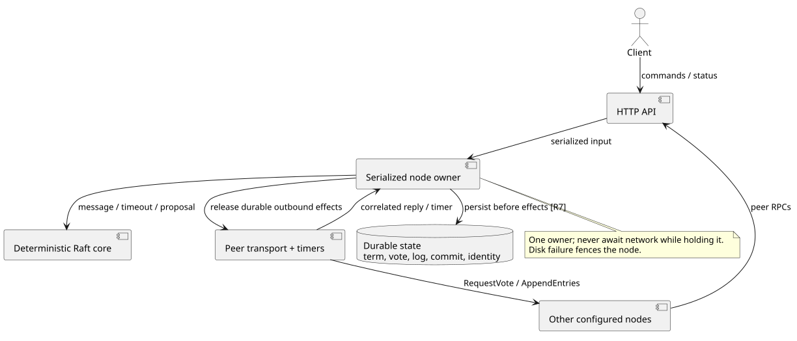
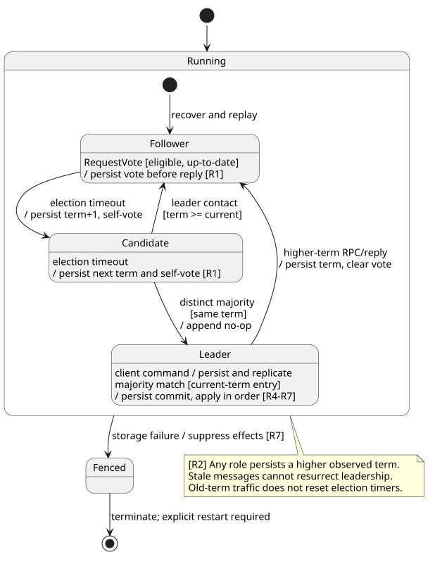
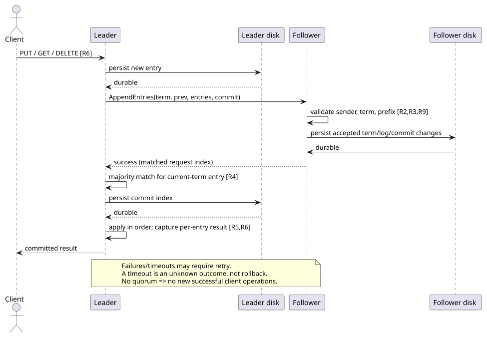

# Raft key-value service: design contract

Status: design-stage contract for a standalone example; choices below are inferred from the user's broad request. Baseline protocol: [Raft extended paper](https://raft.github.io/raft.pdf), Figure 2 and Sections 5 and 8. This document fixes the subset and API semantics; it does not prove correctness.

## UML views

### Ownership

[UML source](design/components.puml)

### Roles

[UML source](design/roles.puml)

### Replication

[UML source](design/replication.puml)

## Scope and ownership

Static, identically configured membership with unique integer node IDs. Support odd clusters of 1, 3, or 5. Each process owns one durable directory, one node owner, one HTTP server, an election timer and outbound peer RPC tasks. The Raft core is deterministic; timeouts and messages are explicit inputs. Never hold the node owner across network awaits. Serialize durable state updates with the core transition; persistence must complete before exposing corresponding success or outbound votes/append requests. On disk error, fence the process rather than continuing from uncertain state. Provide a persistence abstraction/fault seam so tests can fail a save and verify that no dependent reply or outbound effect escapes.

Core state: current term, voted-for, log; role, leader hint, commit index, applied index; leader next/match indexes and candidate unique votes. Entries have 1-based indexes and terms; index 0/term 0 is the virtual empty prefix. Term/vote/log are durable. Persist commit index as well for straightforward replay; the applied KV map can be rebuilt from the committed prefix. Never replay an uncommitted suffix. A cluster/config identity is stored and checked on restart. One process per storage directory is enforced with a lock.

Storage may use a complete state snapshot for simplicity: write temp file, sync file, atomic rename, sync containing directory. This is not Raft snapshot/log compaction. Startup rejects invalid/corrupt state; it must never silently initialize over existing state. No power-loss or filesystem-corruption guarantee beyond the stated fsync/rename assumptions.

## APIs

HTTP JSON. Peers use `POST /raft/vote` and `POST /raft/append`; client uses `POST /kv`; diagnostic `GET /status` is explicitly stale/local.

`/kv` request is a tagged command: `{"op":"put","key":"k","value":"v"}`, `{"op":"get","key":"k"}`, or `{"op":"delete","key":"k"}`. Exact Rust field layout may follow these externally visible names. Response on success contains committed index, term and value (`get`: observed value or null; `put`: assigned value; `delete`: previous value or null).

All client commands, including reads, are log entries. Return success only with the result captured when that exact entry is applied. Followers return 503 with a leader hint if known; no automatic proxy. A leader unable to commit within a bounded timeout returns 504 with an unknown-outcome indication. Retrying a timed-out request can create another operation; no exactly-once or client deduplication claim. A read observes the state at its own log position, not a later map lookup. Each waiting request is identified by its original (term,index,command); if leadership changes or that entry is replaced, it must not receive another entry's result merely because the same index later commits. Fail outstanding waiters on stepdown with an unknown-outcome response.

Limit HTTP bodies, key/value sizes, outbound replication batches, and outstanding client requests. Reject overloaded work before appending when possible. Disk/log growth is explicitly unbounded in this version; no retention or compaction claims. Peer endpoints are for a trusted local/test network, not an authenticated public service. Bind addresses/config are explicit. Enforce configured sender IDs and reject malformed/non-member messages.

## Invariants and constraints

- **R1 Election safety:** at most one elected leader per term. A candidate counts distinct configured voters only. Persist term and self-vote before requesting votes; grant at most one vote per term across restart. Grant only when the candidate's (last term,last index) is lexicographically at least as current as the local log.
- **R2 Term discipline:** terms never decrease across RPCs/restarts. Higher-term messages or responses cause stepdown and clear the old vote. Stale responses cannot advance replication or resurrect leadership. Append responses are correlated with the request term and prefix/last index; delayed failures cannot undo newer success.
- **R3 Log matching:** AppendEntries validates previous index/term. Remove only the conflicting uncommitted suffix; never truncate just because a shorter matching request arrives. Reject attempts to overwrite the committed prefix. Follower commit is bounded by both leaderCommit and the last entry matched by this request, not an unrelated local suffix.
- **R4 Commit safety:** a leader advances commit using a majority of durable match indexes only for an entry from its current term; preceding entries commit indirectly. Leadership appends a current-term no-op to enable inherited entries to commit. Empty heartbeat success acknowledges only the sent prefix, not the follower's entire log.
- **R5 State-machine safety:** different commands can never be applied at the same log index across nodes. Apply strictly in index order once per process history; restart reconstructs state from the durable committed prefix. Local applied and commit indexes never exceed the local log.
- **R6 Client correctness:** successful client operations correspond to committed/applied entries and survive restart and leader replacement under the fault assumptions. An isolated former leader cannot return a new successful read or write without quorum. Returned read/delete results belong to that entry's application point. Diagnostic state is not a linearizable read API.
- **R7 Durability before acknowledgment:** term/vote/log changes and newly committed state are persisted before dependent messages/client successes. Failed persistence fences all consensus/client activity until restart. Invalid storage is an explicit startup failure.
- **R8 Progress:** after a stable reachable majority, working durable storage and fair eventual message/timer delivery, elections and pending/new commands eventually progress. Safety does not assume bounded clock skew or network delay; tests of progress use an explicit quiet/recovery period. Reset election timeout on a granted vote or valid current/higher-term leader contact, not stale traffic.
- **R9 Input/ownership boundaries:** no unconfigured voter counts toward quorum, no concurrent processes mutate one directory, malformed requests do not mutate durable state, membership cannot silently change on restart.

## Allowed / forbidden traces

Allowed: leader A replicates put to A+B, commits; A crashes; B wins with an up-to-date log; B commits its no-op; read returns the acknowledged value.

Forbidden: isolated A receives get, returns its local map as success while B+C have committed a newer value.

Allowed: follower holds uncommitted suffix [x,y]; a delayed AppendEntries matching only x arrives; y remains until an actual conflict is delivered, and y is not committed just because leaderCommit is larger.

Forbidden: node votes for A in term 7, restarts, votes for B in term 7.

Allowed: client times out after put; the put may later commit. The response must not promise rollback.

## Deliberate limits

Static membership; no snapshots/compaction, pre-vote, check-quorum, lease reads, deduplicated clients, TLS/auth, Byzantine defense, or production performance targets. Append full/partial suffixes in bounded batches; retry is allowed. These exclusions must stay visible in the example README. Use actual TCP/HTTP between runnable processes, plus deterministic core tests. No hosted Antithesis run is implied by the research artifacts.
