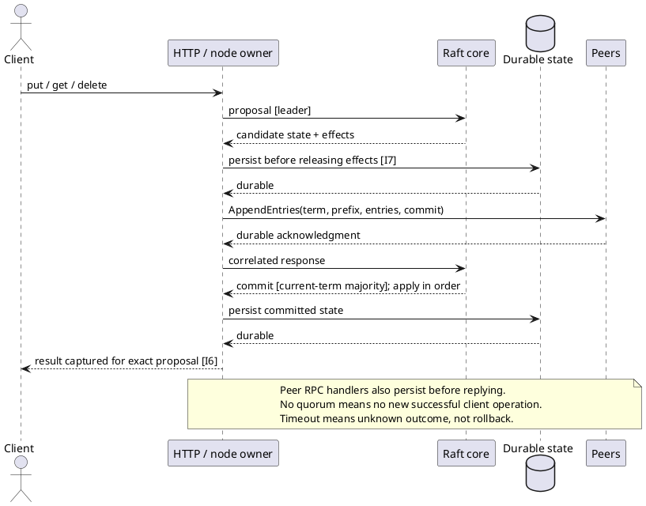
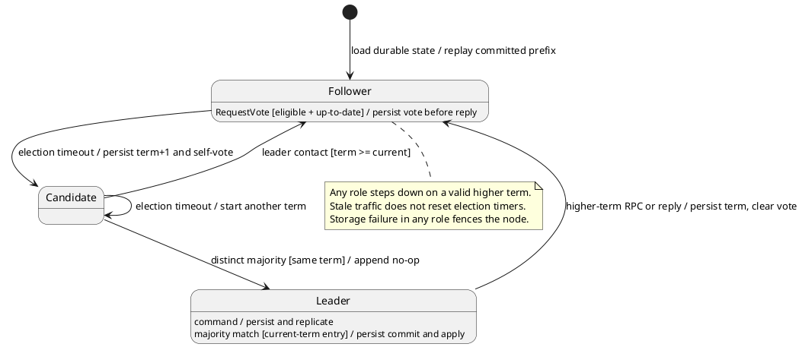

# Raft key-value service

## 1. Outcome and scope

Build a standalone Rust service implementing Raft consensus from scratch, with a durable replicated key-value map and HTTP JSON API. Use runtime, HTTP and serialization libraries; do not use a Raft library.

Scope: static clusters of 1, 3 or 5 nodes; elections, log replication, persistent term/vote/log/commit state, crash recovery, put/get/delete, and deterministic fault testing. Reads are replicated commands for simple linearizable semantics.

Assumptions: identically configured, trusted, non-Byzantine peers; durable storage retained across process crashes. No dynamic membership, snapshots/log compaction, lease reads, client deduplication, TLS/auth, or production performance guarantee. Log growth is unbounded in this version. File durability relies on filesystem fsync/rename semantics; process-crash tests do not establish power-loss safety.

## 2. Design

Rust layout: one Cargo package (edition 2021); `src/lib.rs` owns the deterministic core and its event/effect API, `src/storage.rs` implements persistence, and `src/main.rs` owns HTTP and process orchestration. The core has no HTTP dependency in its control flow; a persistence trait permits real storage and fault injection. Integration tests live under `tests/`. Keep these boundaries cohesive and avoid speculative layers.

Each process has one serialized node owner. The deterministic Raft core accepts messages, timeouts and proposals as explicit events. The owner persists changed durable state before releasing dependent messages or client results. Network requests execute outside the owner; never hold it across a network await. Storage failure fences further consensus/client activity until restart; local diagnostics may remain available.

Durable state: cluster identity, node ID, membership, current term, voted-for, log, commit index. Volatile state: role, leader hint, candidate votes, next/match indexes, applied index, reconstructed KV map, pending client responses. Log indexes start at 1; index 0/term 0 denotes the empty prefix. Rebuild the map from the committed prefix only.

Use an exclusive directory lock that also marks prior initialization. Sync the marker before first state creation. Save state through temp-write → file sync → atomic rename → directory sync. Existing marker with missing state, invalid state, or identity mismatch must fail startup; never silently reset an established node's vote/log. Interrupted initialization fails closed. Deleting all state and markers is outside the retained-storage model.





## 3. Interfaces and constraints

| ID | Interface or constraint | Required behavior |
| --- | --- | --- |
| C1 | `POST /kv` | Tagged JSON: `{"op":"put","key":"k","value":"v"}`, `{"op":"get","key":"k"}`, `{"op":"delete","key":"k"}`. Success returns committed index, term and value: assigned value for put, observed value/null for get, previous value/null for delete. |
| C2 | Client completion | All commands enter the log. Return success only after that exact `(term,index,command)` is committed/applied; capture its result at application time. On stepdown, fail pending waiters as unknown outcome rather than returning a replacement entry's result. |
| C3 | Errors/retries | Followers return 503 with leader hint; no proxy. Commit timeout returns 504 with `unknown_outcome: true`; stepdown/storage failure may return unknown-outcome 503. Retrying may create another operation. A definitive rejection must not append the command. |
| C4 | Peer RPCs | `POST /raft/vote`: term, candidate, last index/term. `POST /raft/append`: term, leader, previous index/term, entries, leader commit. Correlate replies with their original request. Reject malformed and unconfigured sender inputs before mutation. |
| C5 | `GET /status` | Local, potentially stale role/term/leader, commit/applied/log indexes, fencing and pending count. Not a linearizable read; may return 503 under overload. |
| C6 | Resource limits | HTTP body 1 MiB; key nonempty and at most 1 KiB; value at most 16 KiB; replication batch at most 32 entries; at most 128 admitted consensus/client HTTP calls, 128 pending commands, 256 owner-mailbox entries, and one active outbound RPC per peer. Bound response delivery too. |
| C7 | Timers/progress | Randomized election timeout 600–999 ms; heartbeat 100 ms; peer timeout 250 ms. Pending waiters expire after 2.8 s, HTTP waits after 3 s. Reset election timeout only on a granted vote or valid current/higher-term leader contact. |
| C8 | Process/storage | JSON config supplies cluster, ID, bind address, data directory, and member URLs including self. Lock one directory per process. Reject changed identity/membership and corrupt/missing established state on restart. |

## 4. Invariants

| ID | Property | Applies when |
| --- | --- | --- |
| I1 | At most one elected leader per term; one durable vote per node per term. Count distinct configured voters. Grant only to a log at least as current by `(last term,last index)`. | Across messages, duplicates and restarts. |
| I2 | Terms never decrease. Higher terms cause stepdown and clear the previous vote. Old replies cannot resurrect leadership or inflate replication progress; delayed failures cannot undo newer successes. | Valid configured peer traffic; replies retain request correlation. |
| I3 | Matching prefixes remain unchanged. Replace only an actual conflicting uncommitted suffix; a shorter matching append does not truncate. Follower commit cannot advance beyond the prefix matched by that request. | AppendEntries processing, including empty heartbeats. Never overwrite committed entries. |
| I4 | Advance leader commit directly only for a current-term entry durably matched by a majority. Earlier entries commit indirectly. A new leader appends a current-term no-op. | Static membership; heartbeat success acknowledges only its request prefix. |
| I5 | The same applied index has the same command across nodes. Apply consecutively once per process incarnation; `applied <= commit <= log length`. Restart replays only the persisted committed prefix. | Check startup replay before new protocol activity can legitimately commit a retained suffix. |
| I6 | Acknowledged operations survive leader replacement/restart. A new isolated-leader read/write cannot succeed without quorum. Responses belong to their exact proposal and application point. | Retained durable storage; unknown outcomes may later commit. |
| I7 | Persist dependent term/vote/log/commit changes before messages or successes escape. A failed save fences further consensus/client activity. | Include election self-vote, vote grant, leader no-op, follower append and leader commit. |
| I8 | A healthy majority eventually elects and processes new work; repaired replicas catch up. | Stable reachable majority, working storage and fair eventual message/timer delivery. No safety reliance on timing bounds. |
| I9 | Invalid input cannot mutate durable state; nonmembers cannot count toward quorum; only one process owns a data directory. | Configured trusted-peer model and defined input/resource limits. |

## 5. Test cases

Research pass: completed by a separate agent using `antithesis-research` against the design before implementation, with an independent review and later source inspection. This was local research, not hosted Antithesis execution.

| ID | Covers | Setup and action / fault schedule | Expected result | Test method |
| --- | --- | --- | --- | --- |
| T1 | I1, I2 | Repeat one voter's reply in a five-node election; inject a nonmember; vote for A, restart, request vote for B in same term. | No duplicate/nonmember quorum; second same-term vote denied; persisted vote retained. | Deterministic core + restart |
| T2 | I1, I2, C7 | Vary candidate last term/index; deliver higher-term RPC then old vote/append replies; inject stale leader traffic. | Lexicographic freshness enforced; higher term steps down; stale replies do not change leadership/match; stale traffic does not reset timer. | Table cases |
| T3 | I3 | Wrong prefix; shorter matching append over a longer suffix; actual conflicting suffix; attempt committed-prefix overwrite. | Mismatch rejected; matching suffix retained; only conflicting uncommitted suffix replaced; committed prefix intact. | Deterministic core |
| T4 | I3, I4 | Empty/short append with leaderCommit beyond its matched prefix; acknowledge old-term entry by majority in 3/5-node clusters, then current-term no-op. | Unmatched suffix not committed; old-term majority alone insufficient; no-op permits prefix commit. | Deterministic core |
| T5 | I2, I4 | Deliver newer append success then delayed failure; deliver previous leadership term's response after reelection. | Match/next do not regress from stale failure; old term cannot inflate current match. | Reordered replies |
| T6 | I5, I6, C1, C2 | Apply put(a), get, put(b), delete together; retain an uncommitted suffix; reconstruct node before any messages/timers. | Results are a, a, b, b in order; startup map excludes uncommitted suffix. Single-node cluster also commits immediately. | Core + replay |
| T7 | I7 | Fail save during self-vote, vote grant, leader no-op, follower append, proposal or leader commit. | No dependent effects/successes released; last successful durable state retained; node fenced. | Injected persistence |
| T8 | I7, I9, C8 | Reopen saved term/vote/log/commit; try second owner, changed identity/membership, truncated/invalid state, missing established state, marker-only initialization, stale temp beside valid state. | Valid state restores; second owner and invalid/incomplete state fail; stale temp does not replace valid state. | Real filesystem |
| T9 | I1–I5, I8 | Seeded 3/5-node event queue with drop, duplicate, reorder, partitions, old replies and restarts; finish with fair healed delivery. | Independent observer sees no conflicting leaders per term or commands per index, no term regression/apply gap; all nodes eventually apply a fresh command. Retain failing seed/trace. | Deterministic simulation |
| T10 | I6, I8, C1 | Start three HTTP processes; acknowledge put; SIGKILL leader; read through replacement; restart old leader; then kill/restart entire cluster. | Acknowledged values survive and replicas catch up. Clean up only fixture-owned processes. | Real process + disk |
| T11 | I6, C2, C3 | Isolate leader with a pending put; majority elects and writes replacement; start a new read on old leader; heal while old waiter is still pending. | No isolated success; old waiter returns unknown outcome, never replacement result; majority value remains correct. | Six directed HTTP proxies |
| T12 | I6, C1–C3 | Concurrent same-key put/get/delete; record invocation/response history. Also challenge checker with stale reads, definitive rejection and late unknown completion. | Sequential KV history exists respecting real-time order. Rejected work has no effect; unknown work may be omitted or finish after timeout. Checker rejects deliberately invalid histories. | Independent linearizability search |
| T13 | I9, C4–C6 | Oversized/empty keys, oversized values/body, malformed/nonmember RPC; submit 160 commands to an isolated leader before timeout. | Input rejected without durable mutation; batches bounded; at least 32 admission rejections, at most 128 appended commands; status overload is handled. | Core + HTTP |

Test seams: deterministic event input and observable effects/state; injectable persistence; retained durable snapshots for restart; exact proposal identity and captured application results; executable process/config interface. The observer checks elected identities and applied commands, not a second implementation of Raft's quorum/merge logic. Client history validation must not use returned log indexes as its sole oracle.

Persistence-seam failures, actual process kills and physical power loss are different tests. The local plan covers the first two. Hosted exploration would require separately authorized SDK/coverage integration, immutable election/application events, three node containers plus a workload, and confirmed fault support.

## 6. Implementation handoff

Readiness: ready; no unresolved blocking design decisions.

Apply the parent skill’s Rust standard: explicit ownership, recoverable I/O errors, narrow APIs, useful rustdoc, stable formatting and justified lint exceptions. Preserve edition 2021 and the committed lockfile; the example declares no MSRV or optional feature matrix. A Rust-standard review of the existing prototype remains separate from the previously completed behavioral checks; do not claim full conformance from passing Clippy alone.

1. Implement the deterministic core and durable-effects boundary, then file persistence and the HTTP owner/transport. Use `src/lib.rs`, `src/storage.rs`, `src/main.rs` and standard Cargo configuration.
2. Implementation agent runs compilation/existing checks and stops. A fresh test agent implements T1–T13 under `tests/`. Expected outcomes remain fixed; return failures for repair rather than weakening checks.
3. Completion requires the planned local suite, formatting and strict lints to pass; disclose untested boundaries. Reference: [Raft extended paper](https://raft.github.io/raft.pdf), Figure 2 and Sections 5/8.

```sh
cargo build
cargo test --tests
cargo fmt --check
cargo clippy --all-targets -- -D warnings
```

Run from this directory, one process per terminal: `target/debug/speaking-raft config/node1.json`, then node2/node3. Configs use ports 9101–9103 and `data/node1`–`data/node3`. Find a leader through `/status`, then POST a C1 command to its `/kv` endpoint.

Verification: existing implementation passed 16 tests (10 protocol, 3 storage, 3 HTTP), including 48 seeded 700-event fault schedules and real HTTP partition/restart checks; formatting and strict Clippy passed. Source review prompted one startup repair for missing established state. The tests' overload fixture and unknown-outcome oracle were corrected without changing requirements. No hosted Antithesis run or power-loss validation occurred. This consolidated plan includes the startup clarification learned during that exercise; earlier planning artifacts remain in Git history.
